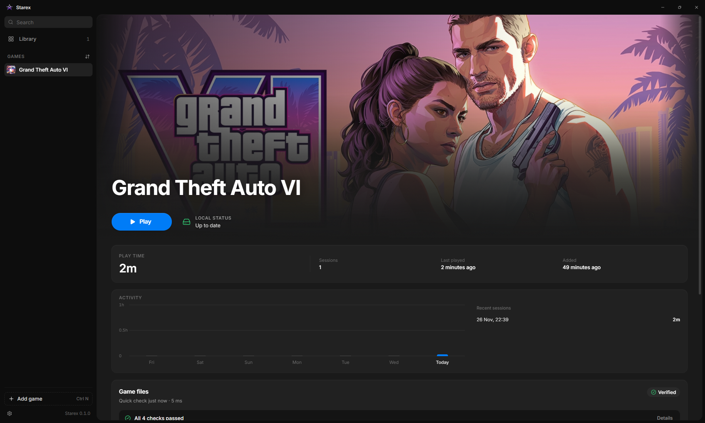

<div align="center">

<h1>Starex</h1>

<p>
  A fast, open-source launcher for the games on your drive.<br>
  Built in Rust & Free.
</p>

<p>
  <a href="https://github.com/setjet/starex/releases/latest"></a>&nbsp;&nbsp;
  <a href="https://github.com/setjet/starex/releases/latest"></a>&nbsp;&nbsp;
  <a href="https://github.com/setjet/starex/releases/latest"></a>
</p>

<p>
  <a href="https://github.com/setjet/starex/releases/latest"></a>
  <a href="https://github.com/setjet/starex/actions/workflows/ci.yml"></a>
  <a href="#install"></a>
  <a href="https://www.rust-lang.org"></a>
  <a href="https://tauri.app"></a>
  <a href="LICENSE"></a>
</p>

</div>

<p align="center">
  
</p>


## What it does

Point Starex at a folder of game files and it gives the game a home: banner art, a Play button
and your play time. New to Starex? Read below to see how it works:

- **Any game folder.** No store or account. Starex finds the right program to start.
- **Fast file checks.** Catches missing or changed files in seconds, with full BLAKE3 hashing
  when you want it.
- **Virus scanning.** Your own antivirus checks a game's code before it is added.
- **Save backups.** Finds saves for 10,000+ games via
  [Ludusavi](https://github.com/mtkennerly/ludusavi-manifest), backs them up after every session
  and can mirror them to a cloud folder.
- **Missing runtimes.** Detects and installs the Visual C++, DirectX and .NET runtimes a game needs.
- **Artwork and details.** Art from [SteamGridDB](https://www.steamgriddb.com) and game info from
  [IGDB](https://www.igdb.com), with a weekly activity chart.
- **Fits your desktop.** Shortcuts, `starex://` launch links, Discord status, tray icon, global
  shortcut and one-switch offline mode.
- **Cross-platform.** Windows, macOS and Linux (Windows games run through Wine), with signed
  self-updates.

## What it can and can't launch

Starex starts programs your computer can run. It does not decrypt, emulate or convert anything.

- PC games run as they would from your file manager. On macOS and Linux, Windows games run
  through [Wine](https://www.winehq.org) when it is installed.
- Console builds (Xbox `.xvc` containers, encrypted GDK packages) cannot run on a PC. Starex
  detects them and says so instead of failing silently. If a community project produces a working
  PC executable for a game you own, Starex can launch that executable like any other.

  ---
## Install

Download Starex for your computer from the [latest release](https://github.com/setjet/starex/releases/latest):

| System | File |
| --- | --- |
| Windows 10 and 11 (64-bit) | `Starex_<version>_x64-setup.exe` |
| macOS 11 or later (Intel and Apple silicon) | `Starex_<version>_universal.dmg` |
| Linux (64-bit) | `Starex_<version>_amd64.AppImage` or `.deb` |

On Windows, Starex installs for your user only and needs no administrator rights. Your library,
settings, artwork, baselines and save backups stay in Starex's data folder (`%APPDATA%\Starex`,
`~/Library/Application Support/Starex` or `~/.local/share/Starex`), and uninstalling leaves it in
place.

The macOS build is not yet notarized by Apple: the first time, right-click Starex in Applications
and choose **Open**.

### Antivirus and modified games

Antivirus programs often flag modified game files, such as cracks, ports and fan patches, even
when they are harmless. When Starex scans or checks a game's files, your antivirus also looks at
them and may quarantine some, which can stop the game from starting. If you trust a game, add its
folder as an exclusion in your antivirus (in Windows Security: Virus & threat protection > Manage
settings > Exclusions). Only do this for files you trust.

## Build from source

You need [Rust](https://rustup.rs) (stable) and [Bun](https://bun.sh) 1.4, plus:

- **Windows:** the [WebView2 runtime](https://developer.microsoft.com/microsoft-edge/webview2/)
  (built into Windows 11).
- **macOS:** the Xcode command line tools (`xcode-select --install`).
- **Linux:** `sudo apt install libwebkit2gtk-4.1-dev libappindicator3-dev librsvg2-dev patchelf libssl-dev libxdo-dev`
  (or your distribution's equivalents).

```sh
bun install
bun run dev      # the app with hot reload
bun run build    # an installer or package in target/release/bundle
```

Before opening a pull request:

```sh
cargo test --workspace
bun run lint
```

## How it is built

| Part | Where | What |
| --- | --- | --- |
| Core | [`crates/starex-core`](crates/starex-core) | Library, folder inspection, program detection, manifests, verification, virus scanning, saves, launch. Plain Rust, no UI. |
| App | [`src-tauri`](src-tauri) | [Tauri 2](https://tauri.app) shell: commands, play sessions, save backups, artwork, updates. |
| Interface | [`src`](src) | [SolidJS](https://www.solidjs.com) and plain CSS on one set of design tokens. |


## Contributing

Issues and pull requests are welcome. [CONTRIBUTING.md](CONTRIBUTING.md) explains the setup, the
commit style and how releases happen.


## Disclaimer

Starex is an independent project and is not affiliated with, endorsed by or sponsored by any game
publisher, developer, storefront or platform holder. All game names, logos and artwork shown in
Starex belong to their respective owners.

Starex only launches software that is already on your computer. It does not provide, download or
unlock games, and it does not bypass copy protection or DRM. You are responsible for making sure
you have the right to use any game you add to it.


## License

[MIT](LICENSE). 
