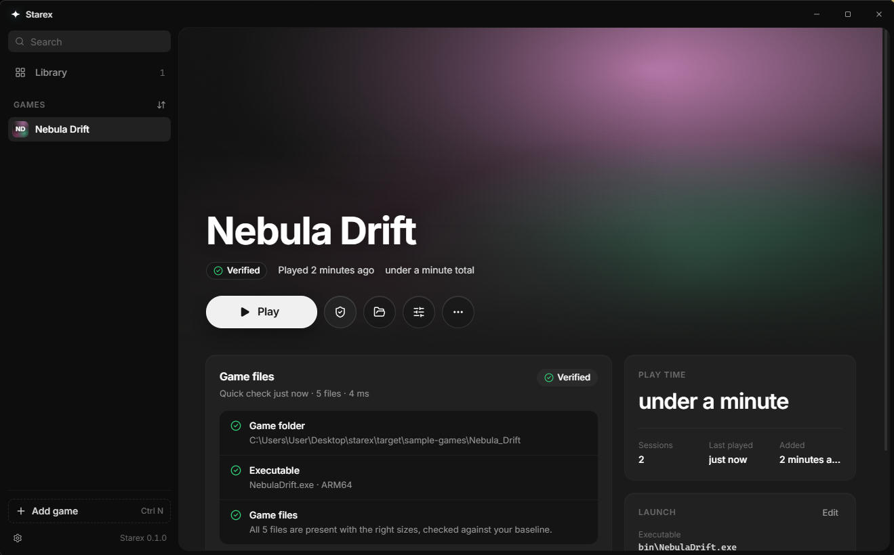

<p align="center">
  
</p>

<h1 align="center">Starex</h1>

<p align="center">
  A clean, fast launcher for the games on your drive.<br>
  Built in Rust. Free and open source.
</p>

<p align="center">
  <a href="https://github.com/setjet/starex/actions/workflows/ci.yml"></a>
  <a href="https://github.com/setjet/starex/releases/latest"></a>
  <a href="LICENSE"></a>
</p>

<p align="center">
  
</p>

## What it does

Point Starex at a folder of game files. It finds the program to start, checks that the files are
complete and safe, keeps your saves backed up, and gives the game a home: banner art, a Play
button and your play time. New to Starex? [How Starex works](docs/HOW_IT_WORKS.md) explains it in
plain words.

- **Any game folder.** No store, account or online check. Launch options, a working folder and
  environment variables per game.
- **Finds the right program.** Starex ranks every program in the folder by name, size, location
  and type, and skips uninstallers, redistributables and crash reporters.
- **Checks the files, fast.** A quick check compares every file's presence and size in seconds. A
  full check hashes every byte with BLAKE3 across all CPU cores. Record a *baseline* while a game
  works, and Starex catches any file that goes missing or changes later. Games can also ship a
  [`starex.manifest.json`](docs/MANIFEST.md).
- **Scans for viruses.** When you add a game, your own antivirus checks its programs and scripts
  (Microsoft Defender or any antivirus registered with Windows; ClamAV on Linux and macOS). Only
  code is scanned, so it takes seconds, and Starex asks before starting a game with threats.
- **Keeps your saves safe.** Starex finds where a game saves, backs the saves up before the first
  launch and after every session, and restores any backup in one click. It also warns when a game
  sits in a read-only folder where it could not save at all.
- **Tells you the truth about a build.** It reads each program's header, so it knows a 64-bit
  game from an ARM one, which system it is built for, and says plainly when a folder holds
  encrypted console files that no PC can run.
- **Follows the game, not just the launcher.** Play time keeps counting when a game's bootstrap
  program hands over to the real one.
- **Beautiful by default.** Banner, cover, logo and icon per game, from your own images, the game
  folder, or [SteamGridDB](https://www.steamgriddb.com) with your own free API key. Games without
  art get their own generated look.
- **Windows, macOS and Linux.** On macOS and Linux, Starex also runs Windows games through Wine.
- **Updates itself.** Signed updates from this repository's releases, installed only when you
  choose.

## What it can and can't launch

Starex starts programs your computer can run. It does not decrypt, emulate or convert anything.

- PC games run as they would from your file manager. On macOS and Linux, Windows games run
  through [Wine](https://www.winehq.org) when it is installed.
- Console builds (Xbox `.xvc` containers, encrypted GDK packages) cannot run on a PC. Starex
  detects them and says so instead of failing silently. If a community project produces a working
  PC executable for a game you own, Starex can launch that executable like any other.

## Install

Download Starex for your computer from the [latest release](https://github.com/setjet/starex/releases/latest):

| System | File |
| --- | --- |
| Windows 10 and 11 (64-bit) | `Starex_<version>_x64-setup.exe` |
| macOS 11 or later (Intel and Apple silicon) | `Starex_<version>_universal.dmg` |
| Linux (64-bit) | `Starex_<version>_amd64.AppImage` or `.deb` |

On Windows, Starex installs for your user only and needs no administrator rights. Your library,
settings, artwork, baselines and save backups stay in Starex's data folder (`%APPDATA%\Starex`,
`~/Library/Application Support/Starex` or `~/.local/share/Starex`), and uninstalling leaves it in
place.

The macOS build is not yet notarized by Apple: the first time, right-click Starex in Applications
and choose **Open**.

## Build from source

You need [Rust](https://rustup.rs) (stable) and [Bun](https://bun.sh) 1.4, plus:

- **Windows:** the [WebView2 runtime](https://developer.microsoft.com/microsoft-edge/webview2/)
  (built into Windows 11).
- **macOS:** the Xcode command line tools (`xcode-select --install`).
- **Linux:** `sudo apt install libwebkit2gtk-4.1-dev libappindicator3-dev librsvg2-dev patchelf libssl-dev libxdo-dev`
  (or your distribution's equivalents).

```sh
bun install
bun run dev      # the app with hot reload
bun run build    # an installer or package in target/release/bundle
```

Before opening a pull request:

```sh
cargo test --workspace
bun run lint
```

## How it is built

| Part | Where | What |
| --- | --- | --- |
| Core | [`crates/starex-core`](crates/starex-core) | Library, folder inspection, program detection, manifests, verification, virus scanning, saves, launch. Plain Rust, no UI. |
| App | [`src-tauri`](src-tauri) | [Tauri 2](https://tauri.app) shell: commands, play sessions, save backups, artwork, updates. |
| Interface | [`src`](src) | [SolidJS](https://www.solidjs.com) and plain CSS on one set of design tokens. |

More in [docs/ARCHITECTURE.md](docs/ARCHITECTURE.md).

## Contributing

Issues and pull requests are welcome. [CONTRIBUTING.md](CONTRIBUTING.md) explains the setup, the
commit style and how releases happen.

## License

[MIT](LICENSE). Game names, logos and artwork shown in Starex belong to their owners. Starex is
not affiliated with any game publisher or platform.
